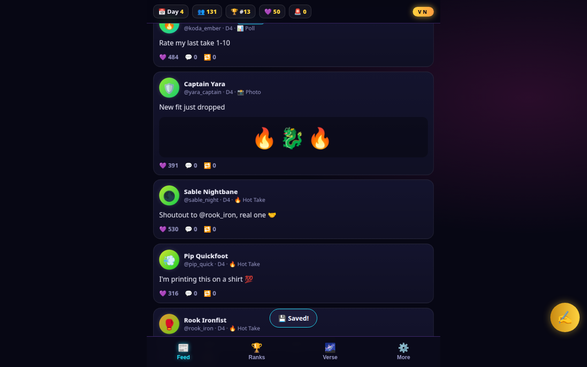

# ✨ VN Influencer-Verse

**Become the #1 influencer in ANY fictional universe — or get canceled trying.**

Pick any universe (free text: ninja realms, wizard schools, tournament sagas — or anything else).
The Verse summons its characters as AI-powered NPC influencers who post, comment, repost,
follow/unfollow, start rumors, feud, and compete with you for the crown. Drop hot takes,
spread rumors, survive drama, and dethrone the reigning #1.

🛡️ **The Narnia test:** only characters from YOUR universe ever appear. Pick Harry Potter and
no one from Narnia will ever show up — crossovers only happen with your explicit opt-in.

## Screenshot

## How to play

1. **Choose a universe** — type any name, or pick a curated parody realm (works offline).
2. **Make your handle** and pick a vibe (Chaos Gremlin / Wholesome / Analyst / Menace).
3. **Post**: hot takes 🔥, rumors 👂, photos 📸, callouts 🎯, collabs 🤝, polls 📊.
4. **Go viral**: engagement → followers. NPCs react with real personality-driven opinions.
5. **Ride the cascade**: engagers expose your post to their follower-graph links — a good post ripples outward. Every post earns a verdict (Flop / Niche Hit / Slow Burn / Viral Hit) with a tip on why it spread (or didn't). Match post type to the crowd's tastes.
6. **Stay consistent, don't burn out**: posting daily builds a streak (+2% followers at 3+ days). 4+ posts in one day builds burnout, which halves engagement until you rest a day.
7. **Reinvention**: stall 3 days at one rank to unlock a one-time pivot — Evolve into a new vibe for a fresh audience, or Double Down for +15% reach at a reputation cost.
8. **Welcome back**: return after 5+ minutes away and your Verse kept growing a little (capped at +5% followers).
9. **Survive**: scandals earn strikes — 3 strikes or 0 reputation = **canceled** 💀.
10. **Win**: reach **#1** on the leaderboard and dethrone the rival 👑.

## The AI (sim-first, always playable)

NPC minds are a **deterministic simulation** — traits, moods, relationships, factions, and a
memory ledger own all game state. A utility-AI layer picks each NPC's *action*; an LLM only
*re-words* the chosen intent. The game is 100% complete with zero AI.

Optional voice tiers (Settings → More):
1. **Puter.js** — one click, no API key, free (default recommendation)
2. **Groq** — paste a free key
3. **Gemini** — paste a free key
4. **WebLLM** — in-browser local model (big one-time download)
5. **Simulated** — built-in personality engine (always works, offline)

Custom-universe casts are generated at runtime **at your request** and validated in 4 layers
(constrained generation → self-verification → Fandom wiki allowlist → runtime roster guard).
Curated packs ship with 100% original parody names — no copyrighted characters in this repo.

## Tech

- Vanilla JS + ES modules, single `index.html`, no build step
- Canvas particle VFX · WebAudio-synthesized SFX (zero audio files)
- localStorage saves (versioned) · mobile-first neon UI
- Free forever: no backend, no account, no paid APIs

## VN signature

A **VN** joint — maximalist neon styling, SFX + VFX throughout.

## License

MIT — see [LICENSE](LICENSE).
